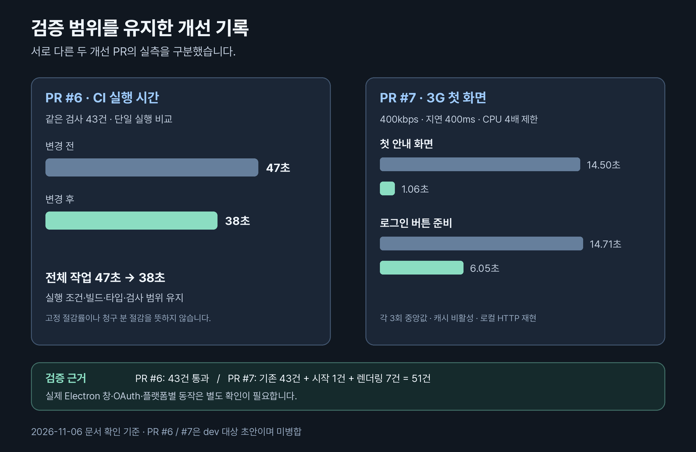

# CI와 초기 렌더링 검증 기록

확인 기준: **2026-11-06**. PR #6·#7의 기존 검증 결과입니다. 두 PR은 `dev` 대상 초안이며 아직 병합되지 않았습니다.

## 검사 범위를 유지한 CI 개선 · PR #6

전체 빌드 뒤 테스트에서 반복되던 core·CLI 빌드를 없애고, 같은 Ubuntu 작업 안에서 세 패키지 테스트를 동시에 실행합니다. desktop의 테스트 전용 컴파일은 유지합니다. Playwright는 기존 테스트가 쓰는 headless shell과 시스템 의존성을 설치하고 사용하지 않는 GUI용 Chromium 다운로드만 제외합니다.

PR과 `dev`·`main` push의 실행 조건, 작업 수 1개, 전체 빌드·타입 검사·43건을 유지합니다. 이전 실행의 빌드나 검사 통과 결과를 재사용하지 않습니다. 자동 배포 워크플로와 릴리스 조건은 바꾸지 않았습니다.

| 단계 | 변경 전 | 변경 후 |
| --- | ---: | ---: |
| 의존성 설치 | 3초 | 2초 |
| 전체 빌드 | 8초 | 9초 |
| 타입 검사 | 6초 | 6초 |
| 브라우저 설치 | 17초 | 12초 |
| 테스트 | 8초 | 3초 |
| 전체 작업 | 47초 | 38초 |

[변경 전 CI](https://github.com/MinsangKwak/a11y-lens/actions/runs/41979605154)와 [개선 CI](https://github.com/MinsangKwak/a11y-lens/actions/runs/41981764347)의 단일 비교입니다. 러너·네트워크 상태에 따라 달라지며 고정 절감률이나 청구 분 절감을 보장하지 않습니다. 단계 시간은 초 단위 타임스탬프 표시이므로 합계와 조금 다를 수 있습니다.

[상세 설계·검사 로그 설명](https://github.com/MinsangKwak/a11y-lens/blob/d6ca6482db6e28ad1c6175851b1d65d092819754/docs/CI.md) · [최종 커밋 CI](https://github.com/MinsangKwak/a11y-lens/actions/runs/41985496337)

## 첫 화면과 배치 갱신 개선 · PR #7

CSS를 HTML 링크에서 먼저 발견하도록 바꾸고 React 대기 화면과 같은 시작 안내를 제공합니다. renderer의 JS·CSS 압축을 명시했으며, resize·ResizeObserver 측정을 프레임당 한 번으로 합치고 동일 좌표의 IPC 재전송을 막습니다. 창 바탕색과 실제 preload 산출물 경로도 맞췄습니다.

| 측정 항목 | 변경 전 | 변경 후 |
| --- | ---: | ---: |
| 초기 JS | 659,851바이트 | 233,600바이트 |
| CSS | 5,472바이트 | 3,857바이트 |
| 첫 안내 화면 FCP 중앙값 | 14.50초 | 1.06초 |
| 로그인 버튼 준비 중앙값 | 14.71초 | 6.05초 |
| CLS | 3회 모두 0 | 3회 모두 0 |

| 재현 조건 | 값 |
| --- | --- |
| 네트워크 | 다운로드·업로드 각각 400kbps, 지연 400ms |
| CPU·캐시 | CPU 4배 제한, 캐시 비활성, 매회 새 컨텍스트 |
| 화면 | 1440 × 940 |
| 전송 | 두 renderer를 동일한 로컬 HTTP에서 압축 전송 없이 제공 |
| 반복 | 변경 전·후를 번갈아 각각 3회, 중앙값 비교 |
| 인증·IPC | 모의 객체 |

첫 안내 표시와 로그인 버튼 준비를 구분한 측정입니다. 실제 Electron의 `file://` 자원이 3G로 다운로드된다는 뜻이 아니며, 실제 OAuth·대상 사이트 로딩 속도 측정도 아닙니다. 기기·캐시·서버 압축·네트워크에 따라 값이 달라집니다. CLS는 두 버전 모두 0이므로 이번 결과로 레이아웃 이동 감소를 주장하지 않습니다.

[원인·재실행 명령](https://github.com/MinsangKwak/a11y-lens/blob/69f0cb603a94d04e265bcb85cecdc67c8c05c037/docs/RENDERING.md) · [원본 실측 JSON](https://github.com/MinsangKwak/a11y-lens/blob/69f0cb603a94d04e265bcb85cecdc67c8c05c037/docs/rendering-benchmark.json) · [전체 CI](https://github.com/MinsangKwak/a11y-lens/actions/runs/41991701765)

## 검증 수와 명령의 적용 범위

| 코드 위치 | core | CLI | desktop | 렌더링 | 합계 |
| --- | ---: | ---: | ---: | ---: | ---: |
| `main` | 22 | 전용 회귀 없음 | 전용 회귀 없음 | 없음 | 22 |
| `dev`·PR #6 | 22 | 13 | 8 | 없음 | 43 |
| PR #7 | 22 | 13 | 9 | 7 | 51 |

PR #6은 43건, PR #7은 기존 43건에 창 시작 1건과 브라우저 회귀 7건을 더한 51건이 통과했습니다. 각 CI에서 실패·취소·생략은 0건이며 전체 빌드와 타입 검사도 통과했습니다. 이 문서 수정에서 실행 코드를 바꾸거나 해당 CI를 새로 실행한 것은 아닙니다.

| 위치 | 검증 명령 |
| --- | --- |
| `main` | `pnpm build` → `pnpm typecheck` → `pnpm test` |
| `dev` | 고정 lockfile 설치·Playwright 준비 후 `pnpm build` → `pnpm typecheck` → `pnpm test` |
| PR #6 | 고정 lockfile 설치·headless shell 준비 후 `pnpm verify`. `test:ci` 단독 호출은 같은 실행의 전체 빌드 이후 |
| PR #7 | 고정 lockfile 설치·Playwright 준비 후 `pnpm build` → `pnpm typecheck` → `pnpm test` → `pnpm --filter @a11y-lens/desktop test:render` |

`pnpm verify`·`pnpm test:ci`는 PR #6의 명령입니다. `test:render`와 측정 스크립트는 PR #7에 있습니다. 기본 브랜치에는 아직 없는 명령을 기본 사용법으로 안내하지 않습니다.

실제 Electron 창·OAuth·검사 대상 뷰의 플랫폼별 동작과 Supabase 스키마·RLS 적용은 확인이 남아 있습니다. 자동 검증 통과는 실제 앱 사용 완료나 웹접근성 인증을 뜻하지 않습니다.
